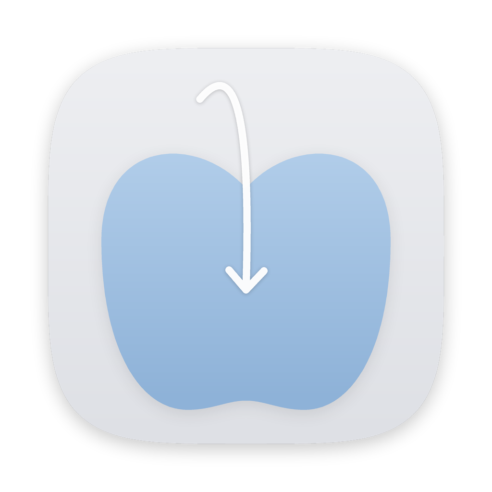

<h1 align="center">Dropfit</h1>

이미지를 끌어다 놓으면, 원하는 포맷으로.

  <a href="https://github.com/realleejeonghoon/dropfit-download/raw/main/Dropfit-macOS.zip"><b>⬇︎ Dropfit 다운로드 (zip, 0.6MB)</b></a>
   현재 버전 0.3.2 (테스트) · 설치 안내 페이지: <a href="https://realleejeonghoon.github.io/dropfit-download/">realleejeonghoon.github.io/dropfit-download</a>

---

## 이렇게 씁니다
1. 이미지나 폴더를 화면에 떠 있는 **Dropfit** 위로 끌고 옵니다.
2. 변환할 수 있는 포맷이 **원형으로 펼쳐집니다.**
3. 원하는 포맷 위에 놓으면 끝. 원본 옆에 새 파일이 생깁니다. 폴더는 옆에 ‘폴더명 (포맷)’ 새 폴더로. (원본은 그대로)

지원 포맷: **JPG · PNG · HEIC · TIFF · GIF · BMP**

## 설치
1. 위 링크에서 **`Dropfit-macOS.zip`** 을 받아 더블클릭해 압축을 풉니다.
2. `Dropfit.app`을 **응용 프로그램(Applications)** 폴더로 옮긴 뒤 실행합니다.
3. "확인되지 않은 개발자" 경고가 뜨면
   **시스템 설정 → 개인정보 보호 및 보안 → [그래도 열기]** 를 누릅니다. (처음 한 번만)

> 요구 사양: macOS 14 Sonoma 이상 · Apple Silicon / Intel 모두 지원 · iPhone/iPad 미지원

## 피드백
첫인상, 불편했던 점, 있었으면 하는 기능을 알려 주세요.
